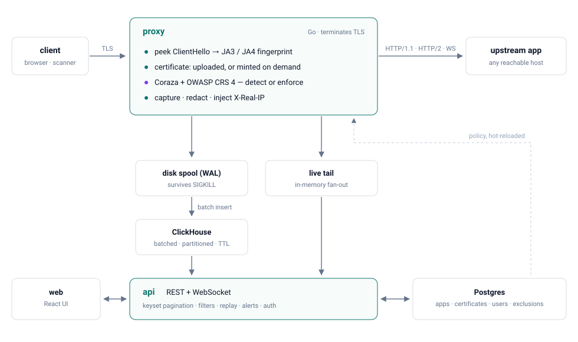
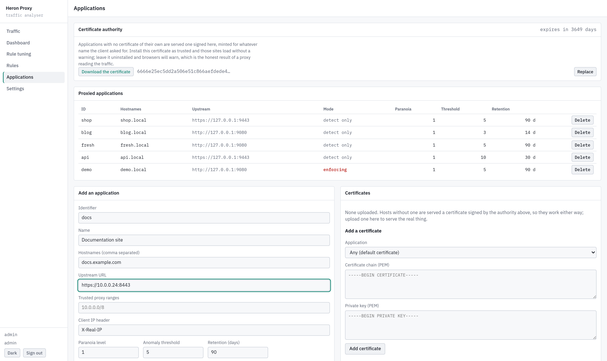
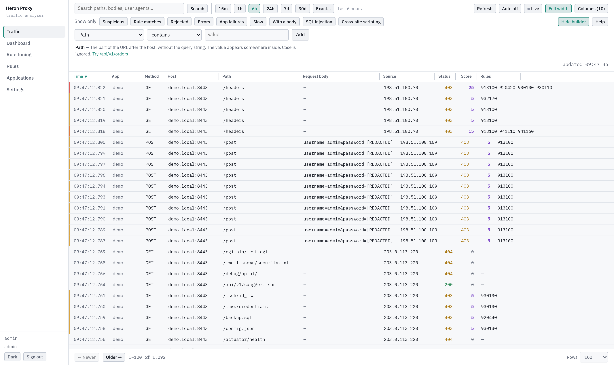
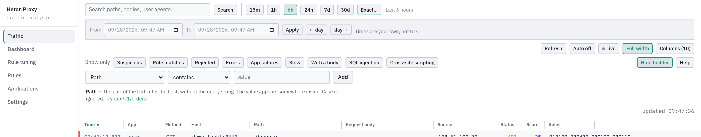
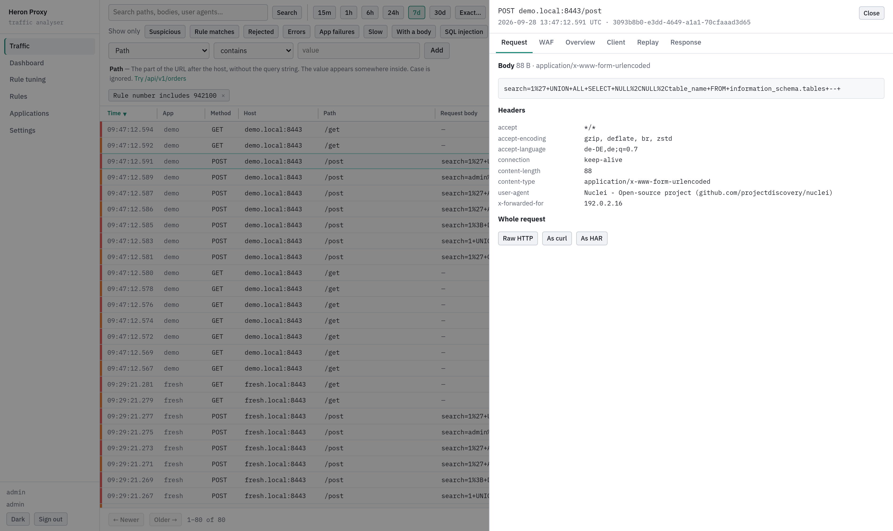
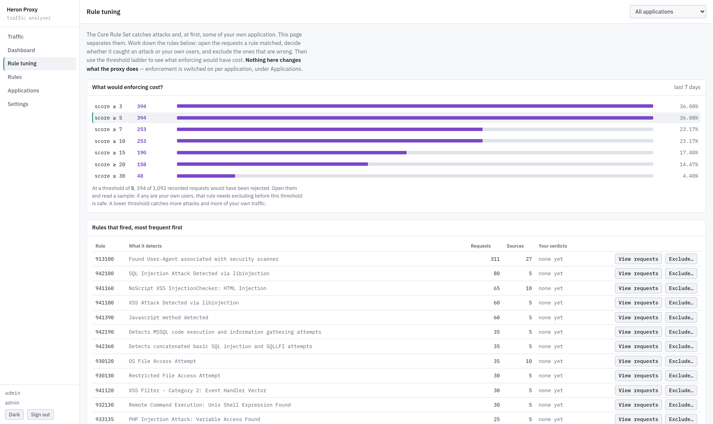
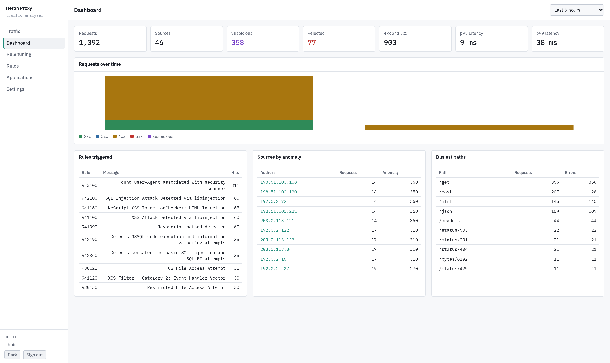
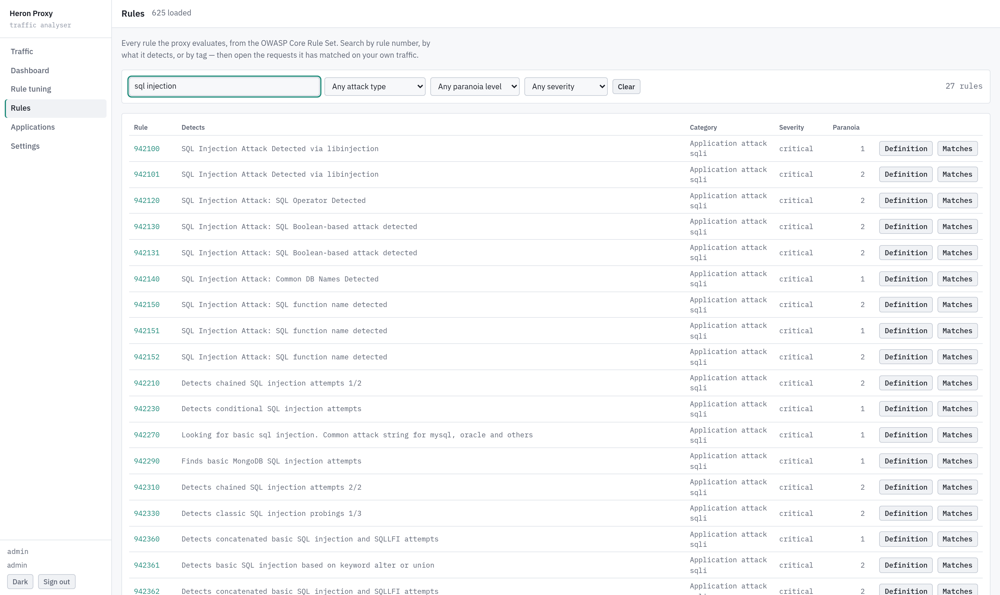

# Heron Proxy

A persistent MITM proxy and WAF traffic analyser.

It terminates TLS for your applications, checks every request against the OWASP
Core Rule Set, records it, and forwards it to an upstream on any reachable host.
Detection comes first: you read what the rules would have done before deciding
whether to enforce it.

> A heron stands in the current, watches everything pass, and strikes only when
> it has decided.



- **Every request recorded** — method, path, query, all headers, body to a cap.
  Response status, headers and size; never response bodies.
- **Works before you prepare anything** — an application with no certificate is
  served one minted by the proxy's own authority.
- **Detects, then optionally enforces** — per application, on the same anomaly
  score the simulator reports.
- **Honest attribution** — the true TCP peer and any claimed `X-Forwarded-For`,
  the latter believed only from a trusted proxy. JA3/JA4 from the ClientHello.
- **Loses nothing** — events hit an on-disk write-ahead log before they are
  acknowledged. `SIGKILL` under load and every one still ships.
- **Fast to query** — ClickHouse with keyset pagination: page 10,000 costs what
  page 1 costs.

## Quickstart

Requires Docker with Compose v2.

```bash
cp deploy/compose/.env.example deploy/compose/.env
$EDITOR deploy/compose/.env     # every value needs changing
make up
```

The UI is on <http://localhost:8081>. Sign in with the `ADMIN_USERNAME` and
`ADMIN_PASSWORD` you set; that account is created on first start only.

`ENCRYPTION_KEY` must be exactly 32 bytes. It encrypts certificate private keys
at rest, and losing it makes stored certificates unreadable.

## Add an application

**Applications** → an identifier, the hostnames it answers on, and the upstream
URL. Point DNS for those hostnames at the proxy. That is the whole setup.



The upstream URL's scheme decides how the proxy reaches it: `https://` keeps TLS
all the way, `http://` means the proxy terminates and forwards plaintext. Turn
off **Verify upstream certificate** for self-signed internal services.

Clients get a certificate you uploaded, or one the proxy mints for the name they
asked for. Install the authority (**Applications → Certificate authority**)
wherever you want no warnings.

## Read the traffic



Search, or build conditions in plain language. 28 columns, resizable and
sortable, keyset pagination, live tail.

Pick a time window: one of the quick ones, which keep sliding, or an exact start
and end in your own timezone.



Opening a request shows the body, every header, and the whole thing as raw HTTP,
curl or HAR. Sensitive values are redacted on the way in.



## Enforce

Nothing is blocked until you say so, per application.



1. Run in detection long enough to see normal traffic.
2. **Rule tuning** ranks the rules that fired. Read what a rule matched, decide
   whether it caught an attack or your own users, exclude the ones that are wrong.
3. The threshold ladder shows what each threshold would have rejected this week.
4. When you trust a threshold, set the application's mode to **Reject**.

## Dashboard and rules

Volume, suspicious and rejected counts, latency percentiles, and the rules,
sources and paths behind them.



All 625 CRS rules, searchable by number, description or tag, each linking to its
own matches in your traffic.



## Documentation

| Guide | Contents |
| --- | --- |
| [Configuration](docs/configuration.md) | Every environment variable and per-app policy |
| [Deployment](docs/deployment.md) | Compose, Kubernetes, TLS, sizing, backups |
| [Filters](docs/filters.md) | Every filterable field and operator |
| [Rule tuning](docs/tuning.md) | False positives, exclusions, enabling enforcement |

## Development

```bash
make build          # both binaries into bin/
make test           # unit tests, no databases needed
make lint           # gofmt and go vet
cd web && npm run dev
```

`make test-all` needs Postgres and ClickHouse; see [Deployment](docs/deployment.md).
`test/lab/` holds traffic generators: `crawler.py` for visitors, `attacker.py`
for eight campaigns of attack payloads. Both refuse any target that is not the
local lab.

## Roles

| | analyst | admin |
| --- | :--: | :--: |
| Browse, search and filter traffic | ✓ | ✓ |
| Request bodies, replay, verdicts, exclusions | ✓ | ✓ |
| Applications, certificates, users, alerts | | ✓ |

## Limitations

- Response bodies are never recorded. Use Replay to fetch a current response.
- WebSocket frames are not captured; the handshake and byte counts are.
- One proxy node. Scaling out needs a broker-backed sink that does not yet ship.

## License

MIT
